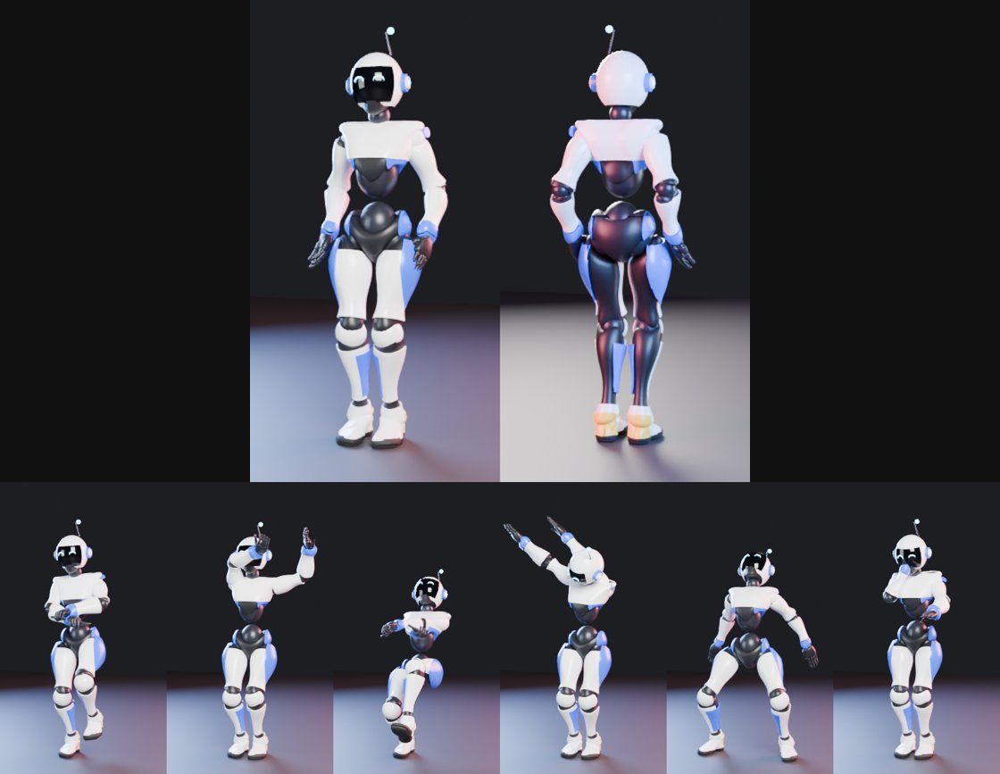

# Volt — le robot danseur

Concept n° 1 du casting (fichier Figma « Aura · Casting v2 »), modélisé sur le squelette de
`sandbox/public/models/all_dances.glb` pour danser les mêmes clips que le Y Bot.



## Comment il est fait

Pas de nouveau corps : **la combinaison noire, c'est le corps du Y Bot** (mesh `Beta_Surface` + `Beta_Joints`),
recoloré, la taille affinée et la boule du bassin réduite.

Les plaques blanches et bleues sont des **coques découpées dans ce même corps** (`shell()`) : on garde un segment
(par os dominant), on le coupe net avec des plans, on le pousse de 1 à 2 cm le long des normales et on l'épaissit.
Chaque coque garde les poids de skinning du corps qu'elle recouvre : elle suit toutes les danses sans réglage.

Le casque (coque blanche, visière noire, yeux LED « ^ ^ », oreillettes, antenne) est **rigide**, à 100 % sur l'os `Head`.

Tout est fusionné en un seul mesh skinné (8 matériaux, ~73 k triangles, 2,8 Mo).

## Refaire le modèle

```sh
pip install bpy                    # Blender en module Python (5.x)
python build_volt.py ../../sandbox/public/models/all_dances.glb ../../sandbox/public/models/skins/volt.glb --blend volt.blend
python render_volt.py volt.blend rendus/v idle:10 quinte:70 idle:10@head   # rendus Cycles de contrôle
```

Les couleurs sont en haut de `build_volt.py` (`M_WHITE`, `M_BLUE`, `M_LED`…), les plaques dans la section « coques ».

## Limites connues

- Le casque est plus gros qu'une tête : sur les danses où la main touche le visage (« CHTTTTT ! »), elle entre un peu dedans.
- Les coques suivent la peau : sur les flexions extrêmes (genou très plié), le bord d'une plaque peut s'écraser.
